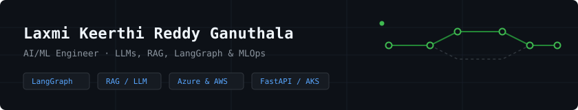

  

 <strong>AI/ML Engineer · 5+ Years Experience · Perplexity (USA) &amp; PwC (India)</strong>  <em>M.S. in Computer &amp; Information Sciences - Montclair State University</em>  <a href="https://www.linkedin.com/">LinkedIn</a> · <a href="mailto:ganuthalalaxmikeerthi.r@mycvcareer.com">ganuthalalaxmikeerthi.r@mycvcareer.com</a> 

### About Me

I design and ship production **Generative AI**, **Agentic RAG**, and **Predictive ML** systems—taking models from data pipelines and evaluation harnesses to containerized APIs on **Azure (AKS)** and **AWS SageMaker**.

### What I Build

| Domain | Core Stack | Measured Impact | 
| ----- | ----- | ----- | 
| **Generative AI & Agentic RAG** | Azure OpenAI, GPT-4, LangChain, LangGraph, FAISS, Pinecone, Azure AI Search | **72% → 87%** top-5 retrieval accuracy across 40K+ docs · **4.2s → 2.8s** latency · **30%** workflow automation | 
| **Predictive ML & NLP** | Scikit-learn, XGBoost, TensorFlow, PyTorch, spaCy, BERT, Pandas, Spark | **76% → 88%** model performance on 500K+ records · **35%** less manual categorization | 
| **MLOps & Cloud Serving** | FastAPI, Flask, Docker, Kubernetes (AKS), AWS SageMaker, MLflow, CI/CD | **45m → 20m** deployment turnaround · **25%** faster downstream API integration | 

### Tech Stack

| Category | Tools & Frameworks | 
| ----- | ----- | 
| **Languages** | `Python` `SQL` `R` `Java` | 
| **GenAI & LLMs** | `Azure OpenAI` `GPT-4` `LangChain` `LangGraph` `RAG` `AI Agents` | 
| **Vector Search & NLP** | `FAISS` `Pinecone` `Azure AI Search` `BERT` `spaCy` `NLTK` | 
| **ML & Deep Learning** | `PyTorch` `TensorFlow` `Keras` `Scikit-learn` `XGBoost` `LSTM` | 
| **Data & Big Data** | `Pandas` `NumPy` `Apache Spark` `PyMuPDF` `PostgreSQL` `Hadoop` | 
| **Cloud & MLOps** | `Microsoft Azure` `AWS SageMaker` `FastAPI` `Flask` `Docker` `Kubernetes (AKS)` `MLflow` `CI/CD` | 
